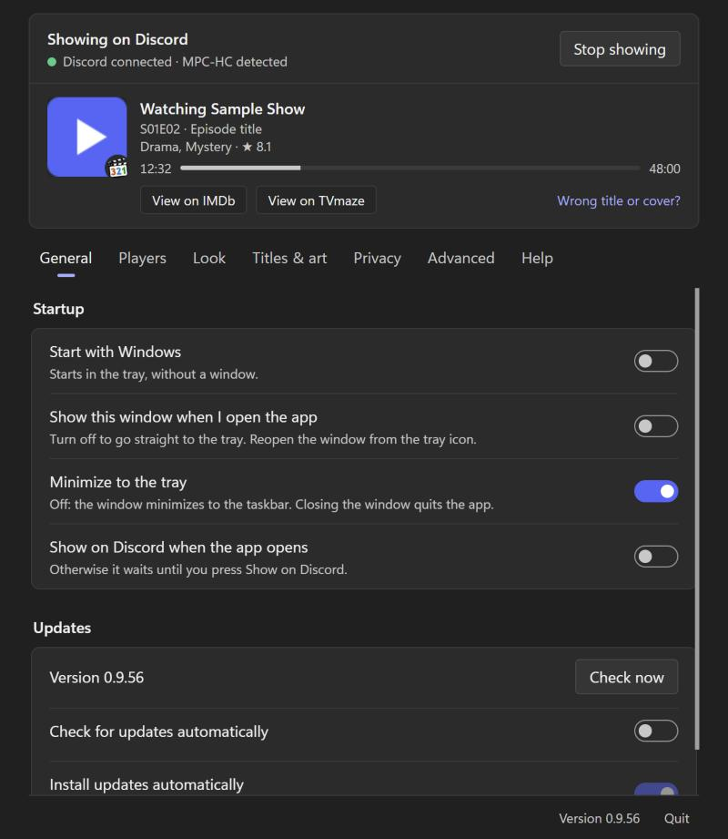
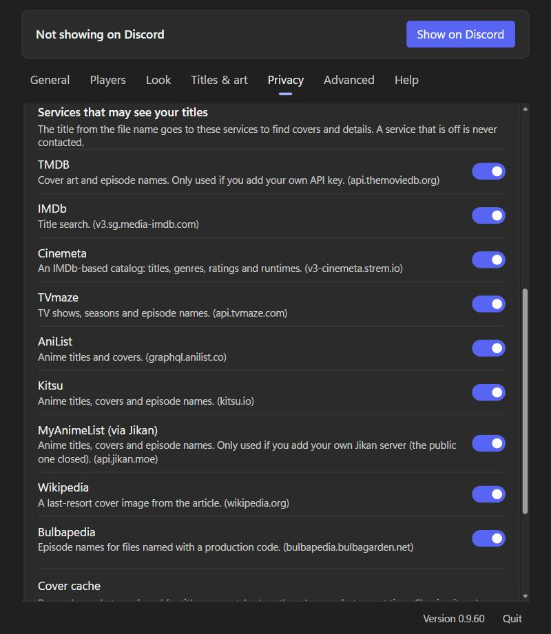

# MPRP

Media Player Rich Presence (formerly MPCvibedRPC)

**Show what you're watching on Discord.** 
A tiny app that turns what your video player plays into a Discord status: the title, the episode, the cover and a
progress bar that keeps up.

Linux on ARM: <a href="https://github.com/CptPakundo/MPRP/releases/latest/download/MPRP-linux-arm64">MPRP-linux-arm64</a> · <a href="https://github.com/CptPakundo/MPRP/releases/latest">All files and what's new</a>

MPC-HC · MPC-BE · MPC-QT · mpv · VLC · PotPlayer · IINA · Kodi · Plex · Stremio · Jellyfin · Emby

Made with AI: the code, tests and docs were written by Claude (Anthropic) from the maintainer's prompts and testing. [How that works](docs/ai.md).

## ✨ What you get

- 🎬 **"Watching Sample Show"** on your profile, with the episode, its title and a progress bar that follows seeking
  and pausing.
- 🧹 **Clean titles** from messy file names: `Show.Name.S01E02.1080p.WEB-DL.x265-GRP.mkv` becomes *Show Name · S01E02*.
- 🖼️ **Cover art, episode names and ratings** from free catalogs (IMDb, TVmaze, AniList and more).
- 🎯 **Fix a match**: a wrong title or cover is put right from the window, with a search that suggests as you type.
  The fix sticks for every episode.
- ✏️ **Text lines your way**: Standard, Short, Detailed, or lines of your own with placeholders such as
  `{episodeTitle}`.
- 🔗 **Clickable**: the lines and the cover open the title's page (IMDb, AniList, ...), next to up to two "View on ..."
  buttons.
- 📡 **On your streams**: while you share your screen, Discord says "Streaming Sample Show" instead of a stream
  without a name.
- 🔒 **Private by design**: hide titles or whole folders, choose which services may see a title, or stay fully offline.
  No tracking.
- 🪶 **Small and quiet**: one file under 10 MB, nothing to install, updates itself (on macOS it links to the download). While Discord is closed it
  rests and asks no player at all.

## 🚀 Getting started

You need the **Discord desktop app** with *User Settings > Activity Privacy > "Share my activity"* on (under
*Games & Apps*; *Activity Settings* in older Discord versions).

**Windows 10 and 11**
1. Download **MPRP.exe** and run it; there is nothing to install. SmartScreen may warn, because the program isn't
   code-signed: choose *More info > Run anyway*. Windows 11's Smart App Control can block it outright
   ([why](docs/troubleshooting.md#is-the-download-safe)).
2. Play something. If your player isn't found yet, press **Set up the player connection** in the window.
3. Optional: **Start with Windows** (General tab) starts it quietly in the tray when you log in.

**macOS 13 or later** (Apple silicon and Intel)
1. Download **MPRP-macos.zip**, open it and move the app to Applications.
2. The app isn't notarized by Apple, so it won't open the first time: go to *System Settings > Privacy & Security* and
   choose **Open Anyway**.
3. It lives in the menu bar. For IINA, press **Set up the player connection** once and reopen IINA.

**Linux** (x64 and ARM64)
1. Download **MPRP-linux-amd64** (or `-arm64`), make it executable (`chmod +x`) and start it.
2. VLC, Celluloid, Haruna and most other video players are found by themselves. For mpv, press **Set up the player
   connection** (it adds one line to `mpv.conf`); the mpv-mpris script works too.
3. There's no tray icon, and closing the window with its X quits the program. Keep the window open or minimised, or
   let it start at login (**General** tab); running it again brings the window back.

**Plex, Stremio, Jellyfin and Emby** (any system): sign in on the **Players** tab (for Jellyfin and Emby, enter your
server's address first). What you play with that account then shows up, on any device.

**Kodi** (any system): in Kodi, turn on *Settings > Services > Control > Allow remote control via HTTP* with a user
name and password, then enter the password (and the address, for a Kodi on another device) on the **Players** tab.

## 📺 Players

| Player | Windows | macOS | Linux | Setup |
|---|:---:|:---:|:---:|---|
| MPC-HC | ✓ | | | one click (switches on its web interface) |
| MPC-BE | ✓ | | | one click |
| MPC-QT | ✓ | ✓ | ✓ | none |
| mpv | ✓ | ✓ | ✓ | one click (a line in `mpv.conf`) |
| VLC | ✓ | ✓ | ✓ | one click on Windows and macOS (its web interface); none on Linux |
| IINA | | ✓ | | one click, then reopen IINA |
| PotPlayer | ✓ | | | none |
| Kodi | ✓ | ✓ | ✓ | its web server on, then its address, user name and password on the Players tab |
| Celluloid, Haruna, SMPlayer, GNOME Videos, Clapper and more | | | ✓ | none |
| Plex (TV, phone, Plex Web, desktop app) | ✓ | ✓ | ✓ | sign in on the Players tab |
| Stremio (desktop app, Stremio Web, TV, phone) | ✓ | ✓ | ✓ | sign in on the Players tab |
| Jellyfin, Emby (any app, web or TV) | ✓ | ✓ | ✓ | server address and sign in on the Players tab |

"One click" is the **Set up the player connection** button in the window; it closes and reopens MPC-HC, MPC-BE or VLC
after you confirm. When several players are open, the one playing a video wins. What each player needs, and how it is
read: [Players in detail](docs/how-it-works.md#players-in-detail).

## 🔧 Settings

Everything is in one window: open it from the tray icon on Windows or the menu bar on macOS; on Linux it is the app's
own window. Settings save as you change them.

| Tab | What you set there |
|---|---|
| General | starting with the system, showing on Discord when the app opens, updates |
| Players | the players on this computer, and the Plex, Stremio and Jellyfin / Emby sign-ins |
| Look | how the status reads: style, text lines, progress bar, links, streams |
| Titles & art | episode titles, anime titles, folder names, **Fix a match** |
| Privacy | hidden titles and files, which online services may see a title |
| Advanced | how often players are checked, Restore defaults |
| Help | Run a check, Copy diagnostics, the log, your stats, About |

Every setting, with its default: [All settings](docs/config.md).

## 🔒 Privacy

- Your status is put together on your computer. Only Discord, the services you allow or sign in to, and GitHub (the
  update check, which you can switch off) are contacted.
- To find a cover, only the **title** (never the file path) goes to the catalogs you allow, each with its own switch.
  One switch keeps the program fully offline.
- **Hide what I'm watching** shows just "Watching a video". **Never show these files** hides folders, names or a whole
  Plex library.
- With Plex, Stremio, Jellyfin or Emby the program only reads what you play. On Windows their sign-ins are kept
  encrypted for your user account.
- Your stats stay on your computer. No analytics, no tracking.

Every address the program connects to, and how to check a download: [SECURITY.md](SECURITY.md).

The Privacy tab

 

## ❓ Help

**Nothing shows on Discord?** Check these first:

1. The Discord desktop app (not the browser) is running.
2. "Share my activity" is turned on in Discord (where: see [Getting started](#-getting-started)).
3. Discord runs normally, not as administrator.
4. The status line at the top of the window says what is missing, for example "No player found". **Help > Run a
   check** tells you what works and what doesn't.

**Reporting a problem:** on the **Help** tab, **Copy diagnostics** copies a report to paste into a
[new issue](https://github.com/CptPakundo/MPRP/issues/new/choose); what it contains is in
[Troubleshooting](docs/troubleshooting.md#reporting-a-problem).

More problems, by player and service, plus updates and uninstalling: [Troubleshooting](docs/troubleshooting.md).

## 📚 Documentation

- [How it works](docs/how-it-works.md): what shows on Discord, title cleanup, covers, Fix a match, each player.
- [All settings](docs/config.md), with their defaults.
- [Troubleshooting](docs/troubleshooting.md): each player and service, updates, uninstalling.
- [Security](SECURITY.md): every address the program connects to, checking a download, reporting a security problem.
- [Contributing](CONTRIBUTING.md) and [the full docs index](docs/README.md): building, testing, the roadmap and the
  decisions behind the program.

## 🙏 Credits

The idea and the approach come from [angeloanan/MPC-DiscordRPC](https://github.com/angeloanan/MPC-DiscordRPC); the
credit for that belongs to its author. Titles, covers and episode names come from TMDB, IMDb, Cinemeta, TVmaze,
AniList, Kitsu, Wikipedia and Bulbapedia ([notices](THIRD-PARTY-NOTICES.md)). MPRP is free software under the
[MIT license](LICENSE), with no warranty.
