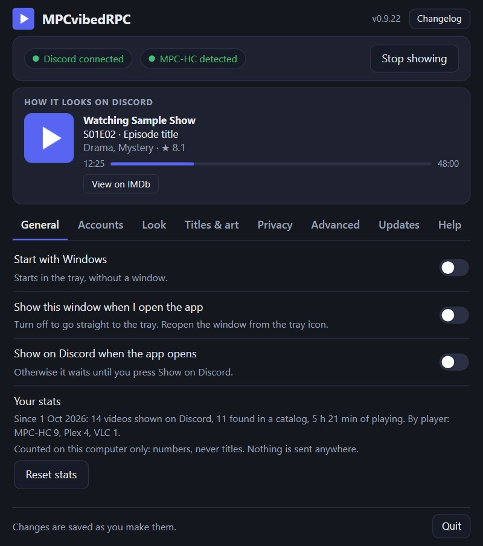
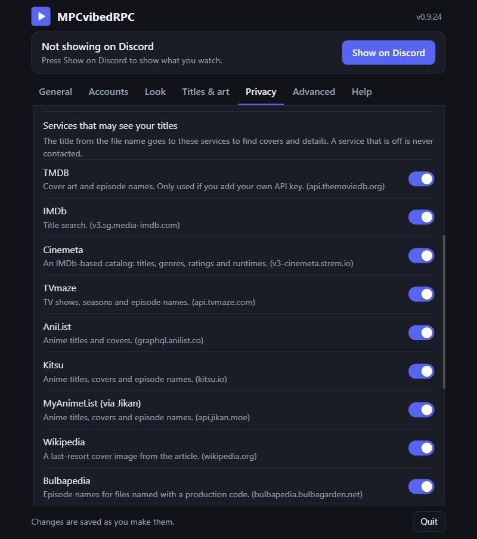

# MPCvibedRPC

**Show what you're watching on Discord.** 
A tiny app for MPC-HC, MPC-BE, MPC-QT, mpv, VLC, PotPlayer, IINA, Kodi, Plex, Stremio, Jellyfin and Emby, with clean titles, cover art and a real progress bar.

Linux on ARM: <a href="https://github.com/CptPakundo/MPCvibedRPC/releases/latest/download/MPCvibedRPC-linux-arm64">MPCvibedRPC-linux-arm64</a> · <a href="https://github.com/CptPakundo/MPCvibedRPC/releases/latest">All files and what's new</a>

> **Made with AI ("vibe coded").** The code, tests and documentation were written by an AI (Claude, by Anthropic) from
> the repository owner's prompts and testing. There is no warranty (see `LICENSE`). The idea and the approach come from
> [angeloanan/MPC-DiscordRPC](https://github.com/angeloanan/MPC-DiscordRPC); the credit for that belongs to its author.

## ✨ What you get

- 🎬 **"Watching Sample Show"** on your profile, with the episode, its title and a progress bar that follows seeking and pausing.
- 🧹 **Clean titles** from messy file names: `Show.Name.S01E02.1080p.WEB-DL.x265-GRP.mkv` becomes *Show Name · S01E02*.
- 🖼️ **Cover art, episode names and ratings**, looked up in several free catalogs (IMDb, TVmaze, AniList and more).
- 📺 **Your players**: MPC-HC, MPC-BE, MPC-QT, mpv, VLC and PotPlayer on Windows; IINA, mpv, VLC and MPC-QT on macOS; VLC, mpv, Celluloid, Haruna and most other video players on Linux; Kodi on any system; and **Plex**, **Stremio**, **Jellyfin** and **Emby** on any device. Each shows with its own logo.
- 🔗 **Clickable**: both text lines and the cover open the title's page (IMDb, AniList, ...), next to the "View on IMDb" button. **Hide what I'm watching** is also in the tray / menu bar menu.
- 🔒 **Private by design**: hide titles or whole folders, choose which services may see a title, or stay fully offline. No tracking.
- 🪶 **Tiny and tidy**: one ~8 MB file, nothing to install, updates itself on Windows and Linux (on macOS it links to the new download). While Discord is closed it rests and asks no player at all.

## 🚀 Getting started

Every system needs the **Discord desktop app** with *User Settings > Activity Privacy > "Share my activity"* turned on (Activity Privacy is in the *Games & Apps* section, called *Activity Settings* in older Discord versions).

**Windows 10/11**
1. Download **MPCvibedRPC.exe** and run it. There is nothing to install. SmartScreen may warn, because the program
   isn't code-signed: choose *More info > Run anyway*.
2. Play something. If your player isn't found yet, press **Set up the player connection** in the window.
3. Optional: **Start with Windows** (General tab) starts it quietly in the tray when you log in.

**macOS 13 or later** (Apple silicon and Intel)
1. Download **MPCvibedRPC-macos.zip**, open it and move the app to Applications.
2. The app isn't notarized by Apple, so the first time it won't open: go to *System Settings > Privacy & Security* and
   choose **Open Anyway**.
3. It lives in the menu bar. For IINA, press **Set up the player connection** once and reopen IINA.

**Linux** (x64 and ARM64)
1. Download **MPCvibedRPC-linux-amd64** (or `-arm64`), run `chmod +x` on it and start it.
2. VLC, Celluloid, Haruna and most other video players are found by themselves. mpv: press **Set up the player
   connection** (it adds one line to `mpv.conf`); the mpv-mpris script works too.
3. There's no tray icon: run the program again to show its window.

**Plex** (any system): sign in on the **Accounts** tab. Whatever you play with your Plex account then shows up, on any device.

**Stremio** (any system): sign in on the **Accounts** tab. What you watch with your Stremio account then shows up, on any device.

**Jellyfin and Emby** (any system): enter your server's address and sign in on the **Accounts** tab.

**Kodi** (any system): in Kodi, turn on *Settings > Services > Control > Allow remote control via HTTP* with a user
name and password; enter the password (and the address, for a Kodi on another device) under **Advanced > Players**.

## 📺 Players

| Player | Windows | macOS | Linux | Setup |
|---|:---:|:---:|:---:|---|
| MPC-HC | ✓ | | | one click (switches on its web interface) |
| MPC-BE | ✓ | | | one click |
| MPC-QT | ✓ | ✓ | ✓ | none |
| mpv | ✓ | ✓ | ✓ | one click (a line in `mpv.conf`) |
| VLC | ✓ | ✓ | ✓ | one click on Windows and macOS (its web interface); none on Linux |
| IINA | | ✓ | | one click, then reopen IINA |
| PotPlayer | ✓ | | | none |
| Kodi | ✓ | ✓ | ✓ | its web server on, then its address, user name and password under Advanced |
| Celluloid, Haruna, SMPlayer, GNOME Videos, Clapper and more | | | ✓ | none |
| Plex (TV, phone, Plex Web, desktop app) | ✓ | ✓ | ✓ | sign in on the Accounts tab |
| Stremio (desktop app, Stremio Web, TV, phone) | ✓ | ✓ | ✓ | sign in on the Accounts tab |
| Jellyfin, Emby (any app, web or TV) | ✓ | ✓ | ✓ | server address and sign in on the Accounts tab |

"One click" is the **Set up the player connection** button in the window. It closes and reopens MPC-HC, MPC-BE or VLC
after you confirm. Exactly what each player needs, and how it is read, is in
[How it works](docs/how-it-works.md#players-in-detail).

## 🔒 Privacy

- The status is put together on your computer. Only Discord, the services you turn on or sign in to, and GitHub
  (the update check, which you can switch off) are contacted.
- To find covers, the **title** (never the file path) is sent to the catalog services you allow. The **Privacy** tab has
  a switch for each one, plus one switch to stay fully offline.
- **Hide what I'm watching** shows just "Watching a video". **Never show these files** hides folders, names or a whole Plex library completely.
- Music played in a video player shows as "Listening to" and is never looked up in the movie and TV catalogs.
- Your status clears itself after a long pause (30 minutes, adjustable).
- **Your stats** (General tab) count videos and watch time on your computer only. Nothing is ever sent anywhere: no
  analytics, no tracking. The download count above is GitHub's public count of release downloads.
- With Plex, the program talks to plex.tv and your Plex server only while you're signed in, and only reads. The same
  goes for Stremio and Stremio's servers, and for Jellyfin / Emby and your own server.
- [SECURITY.md](SECURITY.md) lists every address the program connects to, and how to verify a download (release files
  come with checksums and a signed build record).

## ❓ Help

**Nothing shows on Discord?** Check these first:

1. The Discord desktop app (not the browser) is running.
2. *User Settings > Activity Privacy > "Share my activity"* is turned on (under *Games & Apps*, or *Activity Settings* in older Discord versions).
3. Discord runs normally, not as administrator.
4. The status line at the top of the window says what is missing, for example "No player found".

**Reporting a problem:** on the **Help** tab, **Copy diagnostics** copies the version, the settings you changed and the
recent log. It names what you played, so a wrong title can be traced; folder paths, sign-ins and keys are left out.
Paste it into a
[new issue](https://github.com/CptPakundo/MPCvibedRPC/issues/new/choose).

More problems, by player and service, plus updates and uninstalling: [Troubleshooting](docs/troubleshooting.md).

## 📚 More

- [How it works](docs/how-it-works.md): title cleanup, cover lookups, and each player in detail.
- [All settings](docs/config.md), with their defaults.
- [Troubleshooting](docs/troubleshooting.md): each player and service, updates, uninstalling.
- [Security](SECURITY.md): every address the program connects to, how to verify a download, and how to report a
  security problem.
- [Contributing](CONTRIBUTING.md): bug reports, building and testing.
- [Development](docs/development.md): building, testing and releasing.
- [Roadmap](docs/roadmap.md): where the program is heading, and what it leaves out on purpose.
