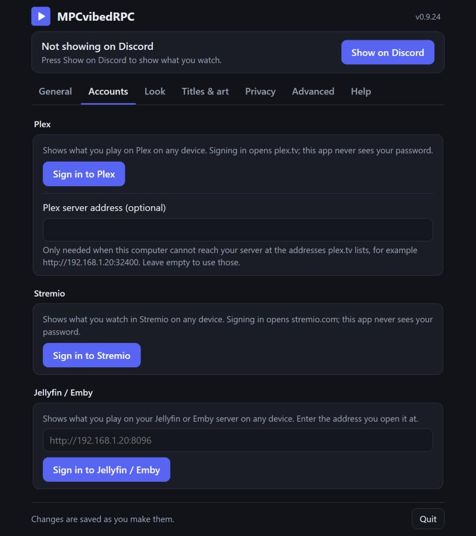

# Troubleshooting

Problems and questions, by player and service. The [README](../README.md) has the first checks, and every setting is
listed in [All settings](config.md).

## Nothing shows on Discord

- The status line at the top of the window says what is going on. "No player found": press **Set up the player
  connection**. mpv and IINA read their settings when they start, so restart them afterwards.
- IINA isn't found: after setting it up, quit IINA completely (IINA > Quit IINA) and open it again.
- macOS 15 or later: a Plex, Jellyfin, Emby or Kodi server on your home network can't be reached until you allow
  it. Answer **Allow** when macOS asks, or turn MPCvibedRPC on under System Settings > Privacy & Security > Local
  Network.
- "Discord on standby" is normal until something plays. If it stays on "Waiting for Discord" while a video plays, use
  the Discord desktop app (not the browser) and check that "Share my activity" is on (User Settings > Activity Privacy, in the Games & Apps section; Activity
  Settings in older Discord versions).
- "Discord refused the connection": Discord runs as administrator and this program doesn't, so Windows keeps them apart.
  Close Discord and start it normally (not with "Run as administrator", and without that setting in its shortcut).
- More than one Discord (Stable, PTB, Canary) open: the status goes to the one that started first, which may be signed
  in to another account. Close the ones you don't use.
- You can't click your own "View on ..." button or links on your profile; that's how Discord works. Others can.
- "Watching Media Player Classic" instead of the title: turn on **Look > Show the title as the activity name**. The name
  after "Watching" is the Discord application's name unless that switch puts the title there.
- mpv-based players (mpv.net, for example) can be read like mpv when they open the same connection: add
  `input-ipc-server=mpvsocket` to that player's own `mpv.conf` (not tested with each of them). Players that drive MPC-HC,
  mpv or VLC, such as Syncplay, work as those players do. Streaming websites in a browser are not read.
- VLC: the window says when VLC refuses the password, or another program uses its port (8080). Change the port in VLC
  and in **Advanced > VLC web interface port**.
- Linux: a player that isn't found probably doesn't offer MPRIS, or isn't on the list yet (music players and browsers
  are left out on purpose). Please report it.
- Music (a song in a video player: `.mp3`, `.flac` and the like) shows as "Listening to" with the file's name; it is not
  looked up in the catalogs, so it gets no cover.

## PotPlayer and Kodi

- PotPlayer (Windows) needs no setup: it is read through the window messages it offers for remote control. An old
  PotPlayer that doesn't send the file's path is named from its window title instead, so the Never show list can only
  match the file name there, not its folder.
- Kodi: turn on *Settings > Services > Control > Allow remote control via HTTP* in Kodi, with a user name and password,
  and enter the same under **Advanced > Players** (the address too, for a Kodi on another device). The window says when
  Kodi refuses the password, or when something else answers at the address. Kodi's web server uses port 8080, like
  VLC's: if both run, change one of them. On Linux, Kodi is also found through MPRIS without any of this. A pause in
  Kodi shows at once when Kodi's *Allow remote control from applications on this system* is on (the default; *on
  other systems* for a Kodi on another device): its notifications come on port 9090. Without it, the pause shows at
  the next check, within 5 seconds.
- Both are tested with the real players on GitHub's Windows test machines (a fresh install, a test video playing),
  not yet on a real desktop. Kodi on macOS, on Linux and on another device was only tried against a stand-in.

## Plex

- The window says when the server can't be reached, or Plex refused the sign-in (then sign out and in again on the
  **Accounts** tab).
- A server on your network that isn't found: put its address in **Accounts > Plex server address**, for example
  `http://192.168.1.20:32400`.
- Plex apps report every few seconds, so the status can lag that much behind. On your own server only *your* playback
  is shown; music and photos never are.
- Tried with the official Plex Media Server on GitHub's test machines. A real Plex account and real Plex apps haven't
  been tried yet; reports are welcome.

## Stremio

- Stremio's player saves where you are in your library when you start, pause or stop, and every 180 seconds while it
  plays (90 seconds in older Stremio apps). The program reads that, so a video shows up within about 20 seconds, and
  pausing takes the status down (the library doesn't tell a pause from a stop). If Stremio is closed without a word,
  the status goes after about four minutes.
- Only videos with a catalog entry are in the library; local files and add-ons without one aren't shown.
- Newer Stremio apps can show a Discord status of their own. Turn that off in Stremio's settings, or you may see two.
- Tried against a stand-in for Stremio's servers only. A real Stremio account hasn't been tried yet; reports are welcome.

## Jellyfin and Emby

- Type the address the way you open the server in a browser; `http://` is added if missing, and a path (for a reverse
  proxy) is kept. The window says when the server can't be reached or refused the sign-in.
- Jellyfin: press **Sign in**, then enter the 6-digit code in a Jellyfin app or web page where you are already signed
  in (profile > Quick Connect). **Use a password instead** is there if Quick Connect is off. Emby has no Quick Connect:
  use your user name and password. The password goes to your own server once and is never stored.
- Only your own playback is shown, even if you are an administrator; music, audiobooks and photos never are. The server
  is asked every 5 seconds, so the status can lag that much behind.
- Tried with the official Jellyfin and Emby server images on GitHub's test machines. A real server and the real apps
  haven't been tried yet; reports are welcome.

## The window doesn't open

Run the program again, or right-click its tray icon > Open settings. On macOS, click the menu bar icon > Open settings
or open the app again; on Linux, run the program again. Closing the window leaves the program running.

## Wrong title or no cover

The log (**Help** tab, or `mpcvibedrpc.log` in the settings folder) shows each title next to the file name it was
read from, for example `Playing: Sample Show · S01E02 (MPC-HC: "Sample.Show.S01E02.1080p.mkv")`, and lists what each
catalog returned. Under
**Titles & art > Fix a match** you can search under another name or pin your own cover image. A free TMDB key
(**Titles & art > More**) improves some matches. A show found only by TVmaze can take about a minute to get its cover
the first time: TVmaze answers a search slowly until it has it cached.

## Where are my settings? How do I remove it?

Everything is in `%LOCALAPPDATA%\MPCvibedRPC` (macOS: `~/Library/Application Support/MPCvibedRPC`; Linux:
`~/.local/share/MPCvibedRPC`): settings, log, cover cache, your stats, and the window's own browser profile (your
regular browser is left alone). **Open settings folder** (**Advanced > Maintenance**) opens it. Every setting with its
default is in [docs/config.md](config.md).

To uninstall:

1. Sign out of Plex, Stremio and Jellyfin / Emby on the **Accounts** tab first. That ends the sessions on their side.
2. Turn off "Start with Windows" / "Start at login" (General tab).
3. Quit the program, then delete the program and the settings folder above.
4. The player settings that **Set up the player connection** switched on are left as they are: the MPC-HC and MPC-BE
   web interface, the line in `mpv.conf`, VLC's web interface and IINA's option. Switch them off in the player if you
   want them gone.

## Updates

The program checks for new versions when it starts and once a day (switch it off under **General > Updates**). On Windows
and Linux, **Install** downloads the new version, checks it and restarts; on macOS the window links to the
download. When an update is available, a line at the top of the window says so, with a **See what's new** button. After
an update the window shows what's new once; the version number at the top of the window shows every version.

## Is the download safe?

The program isn't code-signed, so Windows may say "Windows protected your PC" the first time (More info > Run anyway),
and an antivirus program may flag a new version for a while. Check the file as below before you allow it.

Each release file has a `.sha256` checksum next to it, and GitHub keeps a signed record that it was built from this
repository. With the [GitHub CLI](https://cli.github.com/): `gh attestation verify MPCvibedRPC.exe --repo CptPakundo/MPCvibedRPC`.
See [SECURITY.md](../SECURITY.md).

## Reporting a problem

On the **Help** tab, **Copy diagnostics** copies the version, the settings you changed, how the current title was
found (the file name, what was read from it, which catalog matched) and the recent log. It names
the titles and file names you played (that is how a wrong title is traced); folder paths, sign-ins and keys are left
out. Paste it into a [new issue](https://github.com/CptPakundo/MPCvibedRPC/issues/new/choose).
